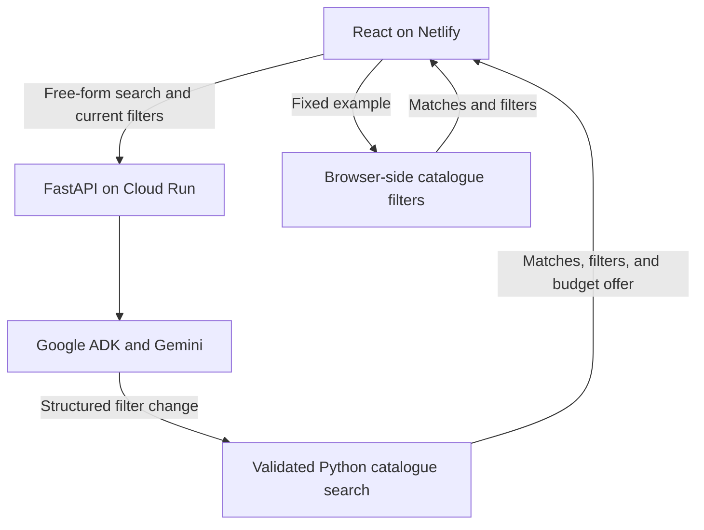

# Product Finder AI Agent

A lightweight, full-stack Product Finder built with one Google Agent Development Kit (ADK) agent, deterministic Python filtering, FastAPI, React, Docker, and Google Cloud Run.

## Live application

- Frontend: https://product-finder-adk-chintan.netlify.app
- Cloud Run health: https://product-finder-api-688514789228.us-west1.run.app/health
- API documentation: https://product-finder-api-688514789228.us-west1.run.app/docs

## Original live release

The assignment implementation is complete:

- The original 13-product catalogue supports general searches. A separate fictional jacket catalogue powers the conversational walkthrough.
- One Google ADK agent interprets natural-language search requests.
- Deterministic Python code performs category and price comparisons.
- Less-than, less-than-or-equal, greater-than, greater-than-or-equal, and exact-price operators are supported.
- Combined category and price filters are supported.
- The custom React frontend renders structured product cards.
- The FastAPI backend is packaged as a non-root Docker container.
- The backend is deployed to Google Cloud Run.
- The frontend is deployed to Netlify and calls Cloud Run directly.
- The Gemini API key is stored in Google Secret Manager and is never sent to the browser.

[Portfolio case study](https://chintanpatel.dev/case-studies/product-finder-ai-agent) · [Evaluation fixtures](backend/eval/conversations.json) · [Conversational search release](https://github.com/chintan-02/product-finder-adk-agent/pull/1)

## Conversational search

Use **Start walkthrough** to switch from the original 13 products to the
labelled sample jacket catalogue. Try the suggested follow-ups in order.

| Turn | Expected result |
|---|---|
| Find a black waterproof jacket under $150 | Sample Trail and Summit |
| Make that under $100 | Trail, with black and waterproof preserved |
| Any colour is fine | Trail and Ridge, still waterproof and within budget |
| Only show size XL | Zero exact matches and an offer to raise the budget to $115 |
| Okay, go up to $130 | Summit and Coast, still waterproof and XL |

React sends the previous validated filters with each follow-up. ADK translates
the new message to a patch. The backend validates the merged filters and builds
cards from catalogue data. An omitted filter is preserved, an explicit clear
removes it, and reset starts fresh. The budget offer is the lowest price that
restores a match while preserving the other filters. Applying it requires
confirmation. The storefront also checks that clearing colour preserves the other filters and retries once if the model changes one. The API has no shared conversation storage between requests.

The original catalogue keeps its strict price operators. The sample jacket
walkthrough treats the stated budget as an inclusive cap. Sample listings
are fictional and independent of the original catalogue.

### Evaluation

```bash
python -m unittest discover -s backend/tests -v
python -m backend.eval.run_live http://localhost:8000 --runs 5
python -m backend.eval.run_live https://product-finder-api-688514789228.us-west1.run.app --case walkthrough --runs 5 --turn-delay 8
```

Local checks passed 49 tests, including 15 scripted conversations through
the real ADK runner with a scripted model, plus simultaneous search isolation.
The frontend production build passed. The live evaluator uses the deployed
model and reports filter, result and clarification checks, filter compliance
of the returned cards, first-turn and follow-up p50/p95 latency, and failing
turns.

The hosted walkthrough passed **5 of 5 conversations and 25 of 25 turns** with eight-second spacing. All **35 returned product matches** met the expected filters, including repeat appearances across turns. From Cloud Shell, first-turn p50/p95 was **791/967 ms** and follow-up p50/p95 was **606/1,184 ms** in that run. These are scripted observations on the sample catalogue. Earlier unpaced tests hit Gemini’s free-tier rate limit. The production browser walkthrough also passed.

## Architecture



### Deterministic boundary

The LLM is responsible only for understanding the user's wording and converting it into structured tool arguments such as:

```json
{
  "category": "clothing",
  "price_operator": "lt",
  "price_value": 50
}
```

The LLM does not compare prices, filter the catalogue, or invent product facts. The `find_products` tool passes validated arguments to the Python search service, which performs authoritative category and numeric filtering. The frontend renders product details from the structured tool result rather than parsing the agent's prose.

This separation keeps natural-language interpretation flexible while making the returned catalogue results predictable and testable.

## Storefront examples

| Query | Expected result |
|---|---:|
| `Show all clothing products` | 3 products. The storefront displays running shoes as footwear. |
| `Groceries at most $5` | 3 products |
| `Electronics over $200` | 2 products |
| `Products exactly $49` | 1 product |


## Technology stack

### Backend

- Python 3.12
- Google Agent Development Kit
- Gemini 3.5 Flash-Lite
- FastAPI and Uvicorn
- Pydantic validation
- Docker
- Google Cloud Run
- Google Secret Manager
- Artifact Registry and Cloud Build

### Frontend

- React
- Vite
- Custom CSS
- Netlify

## Repository structure

```text
backend/
  Dockerfile
  app/
    data/products.json
    agent.py
    agent_runtime.py
    config.py
    main.py
    models.py
    product_service.py
  scripts/validate_catalogue.py
  tests/
frontend/
  src/
    components/
    App.jsx
    api.js
    styles.css
docs/
```

## Run locally

### 1. Backend

From the repository root:

```bash
python3 -m venv .venv
source .venv/bin/activate
python -m pip install -r backend/requirements.txt
cp backend/.env.example backend/.env
```

Add your own Google AI Studio key to `backend/.env`:

```env
GOOGLE_API_KEY=your_key
PRODUCT_AGENT_MODEL=gemini-3.5-flash-lite
ADK_APP_NAME=product_finder
ALLOWED_ORIGINS=http://localhost:5173
```

Never commit `backend/.env`.

Start the API:

```bash
uvicorn backend.app.main:app --reload --host 0.0.0.0 --port 8000
```

Check it:

```bash
curl --fail http://localhost:8000/health
```

### 2. Frontend

In a second terminal:

```bash
cd frontend
cp .env.example .env
npm install
npm run dev
```

Set `VITE_API_URL` in `frontend/.env` to the backend origin. For the local FastAPI command above:

```env
VITE_API_URL=http://localhost:8000
```

## Tests and verification

Run the catalogue validator:

```bash
python3 backend/scripts/validate_catalogue.py
```

Expected output:

```text
Catalogue valid: 13 products, IDs 0-12, 4 categories.
```

Run the backend suite:

```bash
python3 -m unittest discover -s backend/tests -v
```

Final verification completed during development:

- 45 backend tests passed.
- Frontend production build passed.
- Local Docker health and live Gemini requests passed.
- Cloud Run health and live chat requests passed.
- Production Netlify-to-Cloud-Run interaction passed.

The tests cover catalogue integrity, immutable models, price boundaries, combined filters, the single-agent definition, tool output, API validation, safe upstream errors, CORS, and the container contract.

## Docker

Build from the repository root:

```bash
docker build \
  --platform linux/amd64 \
  -f backend/Dockerfile \
  -t product-finder-api:local \
  backend
```

Run with a local, ignored environment file:

```bash
docker run --rm \
  --platform linux/amd64 \
  --name product-finder-api \
  -p 8080:8080 \
  --env-file backend/.env \
  -e PORT=8080 \
  product-finder-api:local
```

The container runs as a non-root user, listens on `0.0.0.0`, and respects Cloud Run's injected `PORT` value.

## Cloud deployment

The production backend follows this deployment path:

1. Cloud Build builds the backend Dockerfile.
2. Artifact Registry stores the versioned image.
3. Cloud Run runs the image with zero minimum instances and one maximum instance.
4. A dedicated runtime service account receives access only to the Gemini secret.
5. Secret Manager injects `GOOGLE_API_KEY` at runtime.
6. Explicit CORS origins allow the local and deployed custom frontends.

The frontend is connected to GitHub and deployed by Netlify with:

```text
Base directory: frontend
Build command: npm run build
Publish directory: dist
```

`VITE_API_URL` contains only the public Cloud Run origin. The browser never receives the Gemini API key.

## Design decisions and trade-offs

- **One agent, one tool:** matches the assignment and keeps the execution path easy to explain.
- **Deterministic filtering:** avoids asking an LLM to perform authoritative numeric comparisons.
- **Structured API response:** product cards use validated tool data instead of extracting facts from generated text.
- **Fixed JSON catalogue:** appropriate for the supplied 13-item prototype and requires no database.
- **Request-scoped ADK sessions:** each request loads its prior validated filters and deletes its temporary ADK session afterward. Browser-held filters survive backend instance changes but reset when the page reloads.
- **Scale to zero:** reduces demo cost but can introduce a cold-start delay on the first request.
- **Public demo endpoint:** enables direct browser access; maximum instances and billing alerts reduce cost exposure, but this is not an authenticated production commerce API.
- **External image URLs:** preserved from the assignment dataset. The UI provides an image-unavailable fallback when a source blocks hotlinking or becomes unavailable.
- **Flexible dependency ranges:** suitable for the time-boxed prototype, though a longer-lived production service should use a reproducible lock strategy and automated dependency updates.

## Explicitly out of scope

The assignment explicitly prohibits embeddings, RAG, and multiple agents. Those capabilities are not used.

The following features are also intentionally excluded because they are unnecessary for a fixed-catalogue, 3-5-hour prototype:

- Database
- Authentication and user accounts
- Checkout or payment processing
- Admin dashboard
- LangGraph or another orchestration framework
- Kubernetes
- Learned recommendation model

Adding these features would increase cost and complexity without improving compliance with the assignment's evaluation criteria.

## Known limitations

- Product availability and facts are limited to the supplied catalogue or the explicitly selected sample catalogue.
- The API depends on Gemini availability and free-tier rate limits.
- Scale-to-zero can make the first request slower.
- Some third-party image hosts may block embedded images.
- The public demo is intentionally unauthenticated and should retain conservative Cloud Run scaling limits.

## Walkthrough summary

For a concise demonstration:

1. Submit a natural-language query in the custom frontend.
2. Show the browser request going directly to the Cloud Run `/api/v1/chat` endpoint.
3. Explain how the ADK agent maps language to `find_products` arguments.
4. Show that Python performs the actual filtering against `products.json`.
5. Show the structured JSON response and the rendered product cards.
6. Demonstrate category-only, combined category-price, exact-price, and no-result queries.
